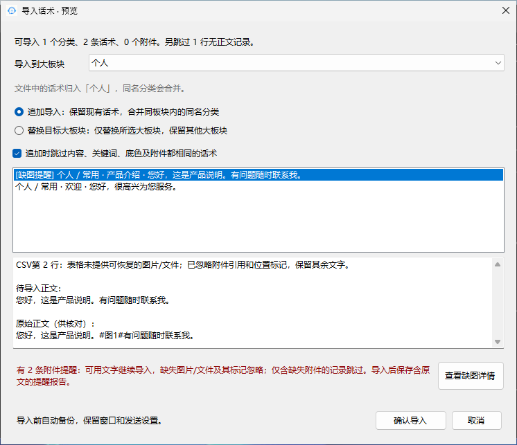
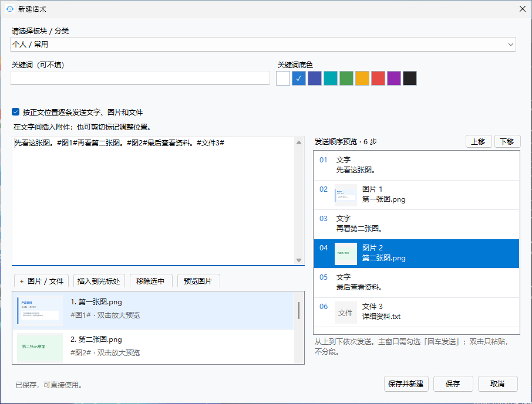
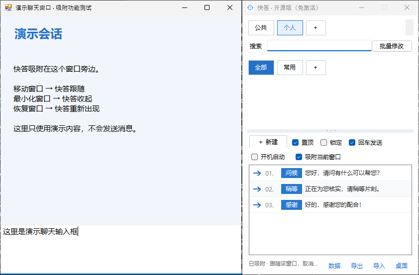

# 快答-聊天宝替代开源app

<p align="center"></p>

<p align="center">
  <a href="https://github.com/zhenbai123/kuaida-chatbao-alternative/releases/latest">下载 Windows 版</a> ·
  <a href="#功能截图">功能截图</a> ·
  <a href="LICENSE.txt">MIT 许可证</a>
</p>

**一个轻量的 Windows 本地话术工具：把常用回复、图片和文件放在桌面悬浮窗里，点击箭头即可发送，双击话术只放入聊天框。**

适合客服、销售及日常重复回复。免激活、无需账号，话术保存在本机，离线即可使用；没有数据库、服务器或 AI 助手模块。使用 C# / WinForms 开发，支持 Windows 10 / 11 64 位。

这是独立开发的聊天宝类工具替代项目，与聊天宝官方无隶属关系；提供的是本项目完整开源代码。

## Excel 导入与缺图处理（v1.8.2）

直接导入聊天宝导出的 `.xls` / `.xlsx` 文字话术，无需安装 Excel 或 WPS。自动识别介绍行之后的表头，保留分类、关键词、正文换行和关键词底色；导入前可选择目标大板块。

表格中有图片或文件引用、但没有提供素材时，先导入文字，只移除缺失附件的 `#图1#` 等位置标记。导入预览可查看缺图详情，导入后在数据目录保存原始正文及缺失引用的提醒报告。仅含缺失附件、没有正文的记录会跳过并记录；CSV 使用相同规则。需要恢复图片时可导入含素材的 `.bangkefu` / `.quickreply`，或在话术编辑器手动添加。

默认勾选「跳过重复」；需要保留表格中的重复话术时可取消勾选。升级请保留整个 `Data/` 文件夹，完整解压软件，并把 `ExcelDataReader.dll` 与 EXE 放在一起。



## 图片、文字和文件按指定顺序发送（v1.8.0）

1. 新建或修改话术，勾选 **「按正文位置逐条发送」**（新建默认勾选）。
2. 输入文字，把光标放在要插入的位置，再添加图片或文件；已有附件可选中后点击 **「插入到光标处」**。已有该附件标记时会移到新位置。
3. 右侧 **「发送顺序预览」** 从上到下显示每段文字、图片缩略图及文件名。选中步骤后点击 **「上移 / 下移」**，即可自己调整发送顺序，正文同步更新；文字内容也可直接在正文修改。
4. 保存后，主窗口勾选 **「回车发送」**，点击话术箭头逐步发送。

正文用 `#图1#`、`#文件3#`、`#附件3#` 等标记表示下方附件的统一编号，标记不作为文字发送。移动标记也可调整顺序，复制标记可重复使用同一附件；未插入正文的附件排在最后，预览会明确提示。调整后相邻的文字会合并为一段，预览立即更新。删除附件会自动更新编号。每条最多9个附件、64步；`.quickreply` 导入导出保留完整顺序。

双击话术或取消「回车发送」时，只把合并后的文字及附件放入聊天框，不执行分段发送。取消编辑器中的逐条发送会移除位置标记，保留正文文字和全部附件。



## .bangkefu 导入兼容（v1.7.3）

支持带表头及无表头的 6 列知识库导出文件。首行的「背景色」作为字段名称识别，不再误当成颜色值。有效的 6 位 RGB 颜色会按原值保留，包含编辑器默认色板之外的颜色；编辑既有话术时也会显示该颜色。

未知列结构、无效颜色或损坏附件仍会明确报错；原文件不被改写。

## 吸附当前窗口（v1.7.2 新增）

先点击要跟随的聊天窗口，再回到快答，勾选「开机启动」旁的 **「吸附当前窗口」**。

- 始终无缝紧贴目标窗口外侧右边，上下对齐且高度一致；移动到屏幕边缘也保持右侧，不自动换边。
- 目标移动、调整大小时，快答随之定位；最小化或隐藏目标时一起收起，目标恢复后自动出现，恢复时不抢输入焦点。
- 吸附期间，箭头发送和双击粘贴固定指向这个窗口，切换其他应用不会更换绑定。
- 取消勾选可恢复自由拖动；目标关闭后自动解除，并把收起的快答显示出来。
- 吸附只在本次运行中有效。重新打开软件后，先点击目标窗口，再重新勾选；升级保留 `Data/` 即可。

吸附不会调整聊天窗口的大小。快答宽度可自行调整，高度随聊天窗口变化；需要自由移动时先取消吸附。右侧空间不足时，超出部分会移出屏幕，请将聊天窗口往左移。发送前仍需先点击目标聊天输入框。



## 功能截图

以下为 Windows 环境运行本项目界面后生成的窗口截图，内容均为演示数据。可通过 `scripts/screenshots.ps1` 重新生成，界面代码与正式程序共用。

| 主窗口：板块、换行分类与一键发送 | 编辑话术：关键词底色及图片缩略图 |
| --- | --- |
|  |  |

| 批量替换：查找后比较替换前后正文 | 导入预览：选择目标大板块 |
| --- | --- |
|  |  |

## 能做什么

| 功能 | 使用方式 |
| --- | --- |
| 一键发送 | 先点击聊天输入框，再点话术左侧箭头；勾选「回车发送」会在粘贴后按 Enter |
| 仅放入聊天框 | 双击话术正文，始终只粘贴，方便修改后自行发送 |
| 吸附当前窗口 | 勾选后无间距贴合选中的窗口，跟随移动、最小化与恢复；关闭目标后自动解除 |
| 悬浮窗口 | 勾选「置顶」保持在其他窗口上方；「锁定」固定位置和大小 |
| 板块与分类 | 公共、个人、自定义大板块；分类按钮自动换行，可滚动并调整分类区高度 |
| 查找与标记 | 按关键词、正文及附件名搜索；支持关键词和彩色底色；悬停预览每行约 25 字 |
| 图文混排顺序 | 在正文光标处插入附件，右侧逐步预览；勾选回车发送后按指定顺序逐条发出 |
| 图片和文件 | 每条话术最多 9 个本地附件，编辑时查看缩略图，双击图片可放大预览 |
| 排序 | 长按话术约 0.35 秒后拖动到指定位置，也可右键上移、下移 |
| 批量修改 | 先查找并预览，再精确替换正文中的文字，保留其他文字、关键词、底色及附件 |
| 导入导出 | `.quickreply` 包含文字与素材；Excel / CSV 用于文字表格，缺图时保留文字；支持已验证结构的 `.bangkefu` 导入 |
| 导入目标 | 可指定导入到某个大板块，追加去重或替换目标板块，导入前自动备份 |
| 桌面与自启 | 启动时创建桌面快捷方式；「桌面」可重建；勾选「开机启动」后随 Windows 登录运行 |

例如，批量查找 `真的` 并替换为 `肯定`，`真的很实惠` 变为 `肯定很实惠`，`这个东西真的假的` 变为 `这个东西肯定假的`。只替换精确匹配的两个字。

## 下载与开始使用

1. 到 [Releases](https://github.com/zhenbai123/kuaida-chatbao-alternative/releases/latest) 下载 `Kuaida-v1.8.2-Windows-x64.zip`。
2. 完整解压到固定且可写的目录，例如 `D:\Apps\Kuaida`，不要在压缩包内直接运行。
3. 双击 `QuickReplyLite.exe`，无需激活码。系统需要 **.NET Framework 4.8**。
4. 新建分类和话术，先点击目标聊天输入框，再使用左侧箭头或双击话术。

发送会使用系统剪贴板和 Windows 粘贴/按键操作。不同聊天软件对图片、文件和 Enter 发送的处理不同，请先在测试会话确认；程序不保证所有聊天软件都支持自动发送附件。以管理员身份运行的目标软件可能需要相同权限才能交互。

桌面快捷方式指向解压后的程序，请保留程序文件夹；移动程序后点击「桌面」重建。软件本身离线运行，使用聊天软件发送消息时仍取决于该聊天软件的网络连接。

## 本地数据与迁移

默认数据位于程序旁的 `Data/`，包含 `话术.json`、备份和 `素材/`。点击右下角「数据」可打开实际目录，**完整复制整个数据文件夹即可备份或迁移**。升级前关闭程序，保留整个 `Data/`。

从其他快答版本迁移时，把旧的 `Data/` 完整复制到本版程序旁即可，无需复制授权文件。不同版本请分开放置。仅在程序目录不可写且没有既有本地数据时，才回退到 `%LOCALAPPDATA%\QuickReplyLite\Data`；以「数据」按钮打开的位置为准。

「公共」是本机的分类板块，不会自动联网同步。需要共享时可以导出话术包，再由其他用户导入。

## 编译与测试

Windows 安装 .NET Framework 4.8 开发环境后，双击 `build-windows.cmd`，输出为 `release/QuickReplyLite.exe`。也可运行：

```powershell
powershell -ExecutionPolicy Bypass -File scripts/build.ps1
```

首次编译需要联网获取固定版本的 ExcelDataReader，构建脚本自动校验 SHA-256；编译后的软件离线运行。不需要 npm、Electron 或任何密钥。本开源版本没有激活窗口、授权校验和管理员签发模块。

核心测试需要 .NET 8 SDK，首次运行从 NuGet 获取固定版本的解析库：

```sh
dotnet run --project tests/CoreTests.csproj --configuration Release
```

Windows 界面截图（仅使用临时目录中的演示数据，不创建桌面快捷方式、不设置自启、不发送消息）：

```powershell
powershell -ExecutionPolicy Bypass -File scripts/screenshots.ps1
```

Windows 吸附集成检查（启动独立的演示窗口，检查跟随、最小化、恢复、目标绑定及关闭处理，并生成吸附截图）：

```powershell
powershell -ExecutionPolicy Bypass -File scripts/test-window-docking.ps1
```

GitHub Actions 负责 Windows 编译、核心测试、吸附集成检查、界面截图和 ZIP 打包。维护者手动运行工作流并勾选发布选项后，才会生成 Release；普通推送只验证并保存构建产物。

核心测试覆盖本地保存、备份恢复、分类板块、批量替换、话术包导入导出、附件校验、排序及快捷方式管理逻辑。自动生成界面截图不等同于所有聊天软件的发送兼容性测试；实际聊天发送、桌面快捷方式与开机启动仍建议在自己的 Windows 电脑上验证。

## 源码结构

```text
src/                 WinForms 窗口、本地存储、发送与导入导出
tests/               无第三方测试框架的核心逻辑检查
assets/              应用图标
scripts/             Windows 构建、演示截图与发布打包
docs/screenshots/    使用演示数据生成的实际程序窗口
FORMAT.md            快答导入导出格式说明
BANGKEFU-FORMAT.md   .bangkefu 已验证格式及兼容范围
```

`.bangkefu` 为第三方格式，仅支持已验证结构的导入，不保证未来所有变体兼容，也不提供该格式导出。发现无法导入的样本时，请不要把私人话术或客户附件提交到公开 Issue。

## 开源许可

采用 [MIT License](LICENSE.txt)，允许使用、修改和再分发，分发时保留许可证及版权声明。欢迎提交问题和改进。

## v1.8.1 Excel 导入修复

支持本地 `.xls` / `.xlsx` 文字话术导入，可跳过介绍行识别表头，兼容“话术”“背景色”和必填标记，保留正文换行、关键词、RGB底色和两级分类。导入前选择目标板块；含外部附件引用时保留文字继续导入，忽略缺失图片/文件及其占位符，并保存含原文和引用的提醒报告。无需安装 Excel/WPS。

随软件附带 [ExcelDataReader 3.9.0](https://github.com/ExcelDataReader/ExcelDataReader)（MIT），`ExcelDataReader.dll` 必须放在 EXE 旁边，版权许可见 `vendor/ExcelDataReader/LICENSE.txt`。

## v1.8.2 缺图表格仍可导入文字

修复含图片引用的 Excel 被整体拒绝的问题。现在保留全部可用正文、分类、关键词和底色，只移除没有附件的图文占位符。导入预览可查看缺图详情，导入后在数据目录保存原文及引用；仅有缺失附件的行跳过并记录。CSV也采用相同处理。
