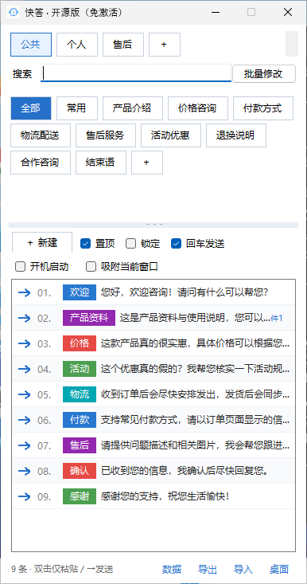
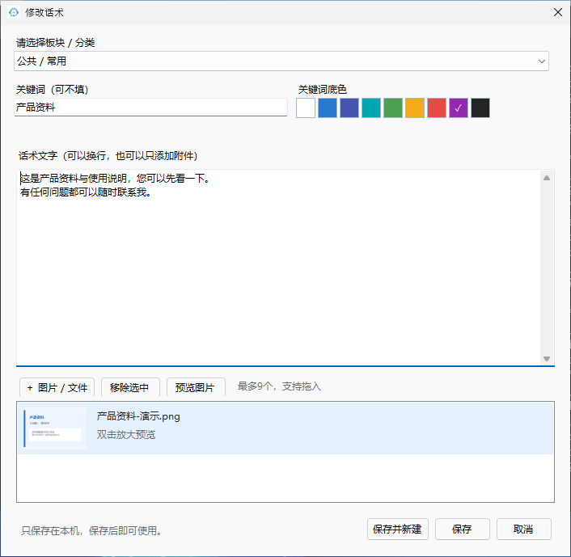
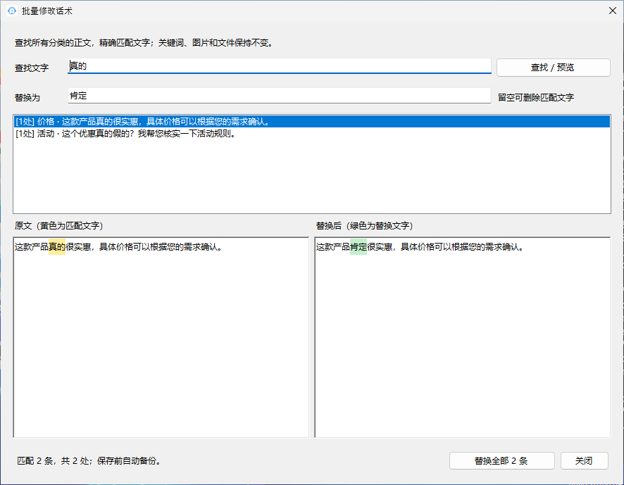
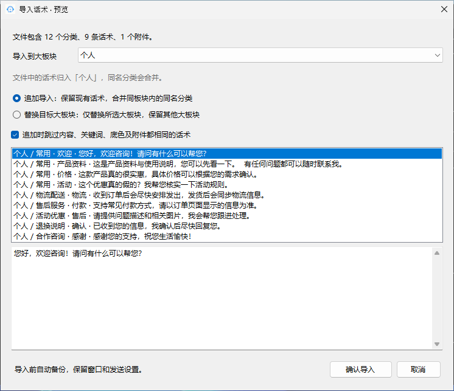

# 快答-聊天宝替代开源app

<p align="center"></p>

<p align="center">
  <a href="https://github.com/zhenbai123/kuaida-chatbao-alternative/releases/latest">下载 Windows 版</a> ·
  <a href="#功能截图">功能截图</a> ·
  <a href="LICENSE.txt">MIT 许可证</a>
</p>

**一个轻量的 Windows 本地话术工具：把常用回复、图片和文件放在桌面悬浮窗里，点击箭头即可发送，双击话术只放入聊天框。**

适合客服、销售及日常重复回复。免激活、无需账号，话术保存在本机，离线即可使用；没有数据库、服务器或 AI 助手模块。使用 C# / WinForms 开发，支持 Windows 10 / 11 64 位。

这是独立开发的聊天宝类工具替代项目，与聊天宝官方无隶属关系；提供的是本项目完整开源代码。

## 功能截图

以下为 Windows 环境运行本项目界面后生成的窗口截图，内容均为演示数据。可通过 `scripts/screenshots.ps1` 重新生成，界面代码与正式程序共用。

| 主窗口：板块、换行分类与一键发送 | 编辑话术：关键词底色及图片缩略图 |
| --- | --- |
|  |  |

| 批量替换：查找后比较替换前后正文 | 导入预览：选择目标大板块 |
| --- | --- |
|  |  |

## 能做什么

| 功能 | 使用方式 |
| --- | --- |
| 一键发送 | 先点击聊天输入框，再点话术左侧箭头；勾选「回车发送」会在粘贴后按 Enter |
| 仅放入聊天框 | 双击话术正文，始终只粘贴，方便修改后自行发送 |
| 悬浮窗口 | 勾选「置顶」保持在其他窗口上方；「锁定」固定位置和大小 |
| 板块与分类 | 公共、个人、自定义大板块；分类按钮自动换行，可滚动并调整分类区高度 |
| 查找与标记 | 按关键词、正文及附件名搜索；支持关键词和彩色底色；悬停预览每行约 25 字 |
| 图片和文件 | 每条话术最多 9 个本地附件，编辑时查看缩略图，双击图片可放大预览 |
| 排序 | 长按话术约 0.35 秒后拖动到指定位置，也可右键上移、下移 |
| 批量修改 | 先查找并预览，再精确替换正文中的文字，保留其他文字、关键词、底色及附件 |
| 导入导出 | `.quickreply` 包含文字与素材；CSV 用于文字表格；支持已验证结构的 `.bangkefu` 导入 |
| 导入目标 | 可指定导入到某个大板块，追加去重或替换目标板块，导入前自动备份 |
| 桌面与自启 | 启动时创建桌面快捷方式；「桌面」可重建；勾选「开机启动」后随 Windows 登录运行 |

例如，批量查找 `真的` 并替换为 `肯定`，`真的很实惠` 变为 `肯定很实惠`，`这个东西真的假的` 变为 `这个东西肯定假的`。只替换精确匹配的两个字。

## 下载与开始使用

1. 到 [Releases](https://github.com/zhenbai123/kuaida-chatbao-alternative/releases/latest) 下载 `Kuaida-v1.6.2-Windows-x64.zip`。
2. 完整解压到固定且可写的目录，例如 `D:\Apps\Kuaida`，不要在压缩包内直接运行。
3. 双击 `QuickReplyLite.exe`，无需激活码。系统需要 **.NET Framework 4.8**。
4. 新建分类和话术，先点击目标聊天输入框，再使用左侧箭头或双击话术。

发送会使用系统剪贴板和 Windows 粘贴/按键操作。不同聊天软件对图片、文件和 Enter 发送的处理不同，请先在测试会话确认；程序不保证所有聊天软件都支持自动发送附件。以管理员身份运行的目标软件可能需要相同权限才能交互。

桌面快捷方式指向解压后的程序，请保留程序文件夹；移动程序后点击「桌面」重建。软件本身离线运行，使用聊天软件发送消息时仍取决于该聊天软件的网络连接。

## 本地数据与迁移

默认数据位于程序旁的 `Data/`，包含 `话术.json`、备份和 `素材/`。点击右下角「数据」可打开实际目录，**完整复制整个数据文件夹即可备份或迁移**。升级前关闭程序，保留整个 `Data/`。

从其他快答版本迁移时，把旧的 `Data/` 完整复制到本版程序旁即可，无需复制授权文件。不同版本请分开放置。仅在程序目录不可写且没有既有本地数据时，才回退到 `%LOCALAPPDATA%\QuickReplyLite\Data`；以「数据」按钮打开的位置为准。

「公共」是本机的分类板块，不会自动联网同步。需要共享时可以导出话术包，再由其他用户导入。

## 编译与测试

Windows 安装 .NET Framework 4.8 开发环境后，双击 `build-windows.cmd`，输出为 `release/QuickReplyLite.exe`。也可运行：

```powershell
powershell -ExecutionPolicy Bypass -File scripts/build.ps1
```

不需要 npm、Electron 或任何密钥。本开源版本没有激活窗口、授权校验和管理员签发模块。

核心测试需要 .NET 8 SDK：

```sh
dotnet run --project tests/CoreTests.csproj --configuration Release
```

Windows 界面截图（仅使用临时目录中的演示数据，不创建桌面快捷方式、不设置自启、不发送消息）：

```powershell
powershell -ExecutionPolicy Bypass -File scripts/screenshots.ps1
```

GitHub Actions 负责 Windows 编译、核心测试、界面截图和 ZIP 打包。维护者手动运行工作流并勾选发布选项后，才会生成 Release；普通推送只验证并保存构建产物。

核心测试覆盖本地保存、备份恢复、分类板块、批量替换、话术包导入导出、附件校验、排序及快捷方式管理逻辑。自动生成界面截图不等同于所有聊天软件的发送兼容性测试；实际聊天发送、桌面快捷方式与开机启动仍建议在自己的 Windows 电脑上验证。

## 源码结构

```text
src/                 WinForms 窗口、本地存储、发送与导入导出
tests/               无第三方测试框架的核心逻辑检查
assets/              应用图标
scripts/             Windows 构建、演示截图与发布打包
docs/screenshots/    使用演示数据生成的实际程序窗口
FORMAT.md            快答导入导出格式说明
BANGKEFU-FORMAT.md   .bangkefu 已验证格式及兼容范围
```

`.bangkefu` 为第三方格式，仅支持已验证结构的导入，不保证未来所有变体兼容，也不提供该格式导出。发现无法导入的样本时，请不要把私人话术或客户附件提交到公开 Issue。

## 开源许可

采用 [MIT License](LICENSE.txt)，允许使用、修改和再分发，分发时保留许可证及版权声明。欢迎提交问题和改进。
